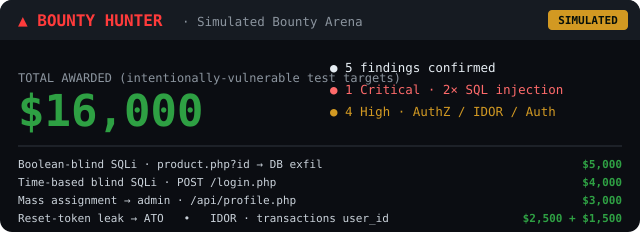
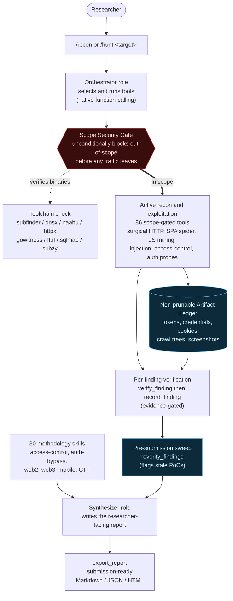

<p align="center">
  
</p>

<h1 align="center">BOUNTY HUNTER</h1>

<p align="center">
  <b>The autonomous AI bug-bounty agent that <ins>exploits</ins>, not just scans — runs as <code>beast</code>, built by Project Hellhound.</b>
  <br><br>
  <i>Point it at a target in plain English. It runs the recon, <b>finds and exploits</b> the bug — XSS proven by a real <code>alert()</code> firing in a headless browser, SSRF driven all the way to cloud-metadata IAM credentials, IDOR chained into account takeover — verifies it with a live class-specific check, and writes a submission-ready report. All behind a scope gate that cannot be bypassed.</i>
</p>

<p align="center">
  <sub><b>recon → exploit → verify → report, on its own</b> &nbsp;·&nbsp; learns mid-hunt from <b>15k+ disclosed HackerOne reports</b> &nbsp;·&nbsp; refuses to file a bug it can't prove &nbsp;·&nbsp; runs <b>free</b> on Ollama / NVIDIA NIM</sub>
</p>

<p align="center">
  <a href="https://github.com/projecthellhound/bounty-hunter/stargazers"></a>
  <a href="https://www.python.org/"></a>
  <a href="https://github.com/projecthellhound/bounty-hunter/releases"></a>
  
  
  
  
</p>

<p align="center">
  <a href="#what-is-this">What Is This?</a> ·
  <a href="#how-it-works">How It Works</a> ·
  <a href="#installation--setup">Installation</a> ·
  <a href="#quick-start">Quick Start</a> ·
  <a href="#capabilities">Capabilities</a> ·
  <a href="#roadmap--whats-next">Roadmap</a> ·
  <a href="#contributing">Contributing</a> ·
  <a href="#license">License</a>
</p>

---

> [!WARNING]
> ### Project Status — Where It Actually Stands
> **Bounty Hunter — "Beast" — is under active development.** An honest read of how it performs across the environments it's run against, so you know what to expect before you point it at anything:
>
> - **Training labs & intentionally-vulnerable ranges** (PortSwigger Web Security Academy, HackTheBox, CTFHub, local hardened labs) — solves them **autonomously, end to end** across a wide range of vulnerability classes: reflected / stored / DOM XSS (confirmed by firing a real `alert()` in a headless browser), SSRF, IDOR and broken access control, authentication/authorization bypass, SSTI, CORS, injection, and exposed-service / secret-leak classes. Not just recon — the full exploit, each one driven to a yes/no and verified before it's recorded.
> - **Multi-host program surfaces** — maps a whole program at once (subdomains, services on non-standard ports, framework/debug endpoints), surfaces the forgotten host or the unauthenticated service sitting one port over from a boring landing page, and works every lead to a result. It can also learn *mid-hunt* from 15k+ **disclosed real-world reports** to copy a proven methodology onto the target in front of it (see the HexBrain integration).
> - **Real, authorized bug-bounty programs** — strong at recon, scoping, triage, and surfacing/verifying genuine issues under the program's rules of engagement. But it is **not yet "fire and forget"** on production targets — **review every finding before you rely on it or submit it.**
>
> What it reports is meant to be a *confirmed* bug, not a guess: an XSS has to actually execute (or demonstrably render unsanitized in an executing sink) to be recorded, `verify_finding` runs class-specific live checks, each distinct confirmed bug is recorded the moment it's proven, and a dismissed false positive can't silently reappear. Use responsibly and strictly on authorized targets.

---

## What Is This?

**Bounty Hunter** (nickname **"Beast"**) is an **autonomous AI agent for bug bounty and penetration testing**, built by **Project Hellhound**. Give it a target and a goal in plain English — it runs the recon, finds *and exploits* the vulnerability, and writes a submission-ready report, all behind a scope gate that can't be bypassed. Built for bug-bounty hunters, pentesters, and CTF players.

**What makes it different:**

- **It exploits, not just scans.** It proves DOM and stored XSS by firing a real `alert()` in a headless browser, forges JWTs, and chains IDOR into account takeover — then runs a live `verify_finding` check before recording anything. You get confirmed bugs, not a wall of maybes.
- **It refuses to fabricate findings.** A "privileged access" or "solved" claim is rejected unless the captured HTTP responses actually back it. No hallucinated criticals, no reports that collapse at triage.
- **It remembers.** A persistent per-target blackboard (tokens, credentials, cookies, open ports, crawl trees, screenshots) under `~/.beast/targets/<target>/` lets hunts resume across sessions with no context loss.
- **Unconditional scope gate.** Every network call is scope-checked before a packet leaves; out-of-scope targets are blocked, always.
- **Free to run.** Works on free NVIDIA NIM credits, commercial APIs (Claude, Gemini, OpenAI), or fully offline via Ollama.

**Two ways to drive it:**

- **Interactive terminal** (`beast`) — a full-screen TUI with live streaming, collapsible tool cards, a findings browser, and a command palette.
- **Headless** (`beast -p "..."`) — one-line runs for scripts and CI pipelines.

---

## Proving Ground — Simulated Bounty Arena

<p align="center">
  
</p>

> **What this is:** a controlled benchmark, not a real-world payout record. Bounty Hunter was run end-to-end against an **internal simulated bounty arena** — intentionally-vulnerable targets (e.g. a mock banking/storefront app) with a triage LLM acting as the program, validating each report and assigning a bounty. It's how we measure the thing the project cares about most: telling a *confirmed* bug apart from a false positive and capturing evidence strong enough to score. Every finding above was confirmed with real captured request/response evidence before it was awarded. Figures are simulated and do not represent real bug-bounty earnings.

**Repeatable scoring.** The loop is "upgrade → test on a lab → did it get better?", so that's measured, not eyeballed: [`benchmarks/score.py`](benchmarks/) compares what Beast actually found & recorded against a ground-truth file and reports **recall** (planted bugs found), misses, and false positives. On a multi-host training lab it recently moved **67% → 92% recall at 0 false positives** across a batch of recon/learning upgrades — and caught a finding-dedup regression a manual read would have missed. Ground-truth answer keys stay out of the repo so no lab walkthrough ships with the tool.

---

## How It Works



> **Orchestrator vs Synthesizer are ROLES, not model tiers.** Orchestrator calls select/run tools (native function-calling); Synthesizer calls write the researcher-facing prose at the end of a turn. Both can point at the SAME model — e.g. the recommended NVIDIA Nemotron 550B config below runs both roles on one model — or at two different ones if you want a cheap/fast model for tool selection and a stronger one for write-ups. Either way, the synthesizer call is always made with the same tool schema attached (just set to "don't call anything"), so it stays in a consistent tool-aware frame of reference for the whole turn rather than being dropped into a schema-free completion right after a history full of the orchestrator's own tool-call JSON.

- **Scope Security Gate**: Unscoped targets are unconditionally blocked before any active network traffic leaves your system.
- **Harvested Artifact Ledger**: Harvested credentials, tokens, session cookies, and delegation endpoints are automatically captured into a structured, non-prunable blackboard and pinned to every turn.
- **Missing Tool Grace**: External tool dependencies are verified on-demand—missing binaries trigger guided installation prompts rather than crashing.
- **Persistent Workspace State**: Target assets, screenshots, history, and extracted findings are stored automatically in isolated target workspaces.

---

## Installation & Setup

Everything you need to install, configure AI backends, and run Bounty Hunter in one unified workflow. The steps below cover the quick path — for more detail on any one piece (model routing options, Burp, or Caido), see the [step-by-step setup guides](docs/README.md).

### 1. Requirements & Prerequisites
- **Operating System**: Linux (Kali, Ubuntu, Debian, Arch, Parrot OS), macOS (Apple Silicon & Intel), or Windows (WSL2).
- **Python**: Version 3.10 or higher (Python 3.12 / 3.13 recommended).
- **Go**: Version 1.20+ (Required for ProjectDiscovery tools, Gowitness, and FFUF).
- **Git & Curl**: Required for installation and updates.

### 2. Fast Deploy (One-Line Pipe or Git Clone)

#### Option A: One-Line Remote Installer
```bash
curl -fsSL https://raw.githubusercontent.com/projecthellhound/bounty-hunter/main/install.sh | bash
```

#### Option B: Standard Git Clone
```bash
git clone https://github.com/projecthellhound/bounty-hunter.git
cd bounty-hunter
chmod +x install.sh
./install.sh
```

#### Reload Shell Environment
```bash
source ~/.bashrc   # or source ~/.zshrc
```

The automated installer will:
- Set up an isolated Python virtual environment at `~/.beast-env`.
- Mount the headless browser & Playwright SPA engine with all system dependencies.
- Verify and install the offensive toolchain (`gowitness`, `subfinder`, `httpx`, `dnsx`, `naabu`, `ffuf`, `alterx`, `tlsx`, `shuffledns`, `subzy`).
- Create a global `beast` command symlink.

---

### 3. AI Backend Configuration

Beast runs two roles — an **Orchestrator** (selects/runs tools) and a **Synthesizer** (writes the researcher-facing report). You point each at a model with `/model orchestrator <provider> <id>` and `/model synthesizer <provider> <id>` (or `/model both <provider> <id>` to set both at once). Pick a provider below.

> [!TIP]
> ### Which model should I use?
> - **Free (recommended):** **NVIDIA NIM** — one free API key works against *any* model it serves (`nvidia/nemotron-3-ultra-550b-a55b`, `meta/llama-3.3-70b-instruct`, …; browse current IDs at [build.nvidia.com/models](https://build.nvidia.com/models), NVIDIA periodically retires old ones). Generous free credits, frontier-class reasoning, zero local GPU.
> - **Paid:** Anthropic **Claude 3.5 Sonnet**, Google **Gemini 2.0 Flash / Pro**, or **OpenAI GPT-4o**.
> - **Local (Ollama):** 32B+ models (`qwen2.5:32b`, `deepseek-r1:32b`) — small local models under 14B struggle with multi-stage IDOR chaining and strict JSON tool-calling.

#### A. Free Cloud AI via NVIDIA NIM (Strongly Recommended for Free Users)
Get free API credits and frontier-class 120B model inference with zero local GPU requirements:
1. Sign up at [build.nvidia.com](https://build.nvidia.com/) to obtain your free API key.
2. Export your key in your environment or `~/.bashrc`:
```bash
export NVIDIA_API_KEY="nvapi-your-key-here"
```
3. Inside Bounty Hunter, select Nemotron or Llama 3.3:
```bash
beast
> /model orchestrator nvidia nvidia/nemotron-3-ultra-550b-a55b
> /model synthesizer nvidia nvidia/nemotron-3-ultra-550b-a55b
```

#### B. Commercial Frontier Cloud Providers (Claude, Gemini, OpenAI)
For researchers with commercial API access:
```bash
# Anthropic Claude
export ANTHROPIC_API_KEY="sk-ant-..."

# Google Gemini
export GEMINI_API_KEY="AIza..."

# OpenAI
export OPENAI_API_KEY="sk-..."
```

Inside the console:
```bash
> /model synthesizer anthropic claude-3-5-sonnet
> /model synthesizer gemini gemini-2.0-flash
```

Want the same model doing both the orchestrator and synthesizer job? You
don't need to run `/model` twice — `/model both <provider> <model-id>`
sets both tiers at once (e.g. `/model both nvidia nvidia/nemotron-3-ultra-550b-a55b`).
See [AI Model Setup](docs/ai-model-setup.md) for the full picture, including
per-tier splits and session-only overrides.

#### C. Fully Offline Local AI (Ollama)
For air-gapped or 100% offline environments (32B+ models recommended for reliable tool chaining):
```bash
# 1. Install Ollama
curl -fsSL https://ollama.com/install.sh | sh

# 2. Pull local model
ollama pull qwen2.5:32b-instruct-q4_0

# 3. Connect inside Bounty Hunter
beast
> /model orchestrator ollama qwen2.5:32b-instruct-q4_0
> /model synthesizer ollama qwen2.5:32b-instruct-q4_0
```

---

### 4. Integrations (MCP) — Burp, Caido & HexBrain

Bounty Hunter can connect external MCP servers as additional tools, alongside
its own built-in arsenal. Two kinds:

- **Interactive proxies** — drive **Burp Suite** and/or **Caido** directly (send
  to Repeater, search captured traffic, push findings). These connect only when
  you actually name them, so an offline proxy never clutters an unrelated turn.
- **Knowledge source** — **HexBrain**, a free hosted corpus of 15k+ *disclosed*
  HackerOne reports mapped to how each bug was found (plus playbooks, payloads,
  bypasses and program payout history). It auto-loads during a hunt so the model
  can learn from what has actually worked on similar stacks.

Each is one command — no manual config editing:

```bash
beast
> /mcp hexbrain sk_your_key          # free key at hexbrainai.com/account (200 calls/day)
> /mcp burp http://127.0.0.1:9876    # auto-detects Burp's MCP transport
> /mcp caido http://localhost:8080   # uses caido-mcp-server if installed, else built-in GraphQL
> /mcp                               # shows current config + live status for all
> /mcp test                          # re-checks without changing anything
```

Full step-by-step guides (getting each key/token, where to find Burp's MCP tab,
`caido-mcp-server`'s OAuth login, and a troubleshooting table for each):
[HexBrain Setup](docs/mcp-hexbrain-setup.md) ·
[Burp Suite MCP Setup](docs/mcp-burp-setup.md) ·
[Caido Setup](docs/mcp-caido-setup.md).

---

### 5. Health Check & Tool Verification
Verify that your environment, AI models, and binary tools are fully connected:
```bash
beast
> /setup
> /setup tools
```

To enable automatic on-demand installation of any missing tools during scans:
```bash
> /setup tools auto-install on
```

#### Third-party recon tool API keys
A few recon tools call external services that need their own free API key (separate from your LLM provider key above) — `/setup` shows exactly which ones are set and which aren't, with a signup link for each. Set any of them with:
```bash
> /setup set-key <tool> <api_key>
```
Every tool in the arsenal that needs one is self-describing this way — run `/setup` any time to see current status rather than hunting through docs for which key goes where.

---

## Quick Start

### 1. Interactive Terminal
Launch the interactive terminal console with live autocomplete and syntax highlighting:
```bash
beast
```

### 2. Headless CLI Automation
Run one-off prompts and scripted pipeline jobs directly:
```bash
# Scoped reconnaissance against a domain
beast -p "recon targetcorp.example"

# Say what you actually want done — the agent picks the right skill and
# recon depth (active vs. passive) itself, it isn't hardcoded off the domain name
beast -p "target is https://lab.ctfio.com and creds user:pass, takeover admin account"

# Direct slash command execution with JSON output
beast -p "/hunt target.com --json"
```

### 3. Never used it before? Your first hunt in 4 steps

No prior security tooling knowledge needed — you talk to it in plain English.

1. **Launch it** — type `beast`. You land in the interactive terminal.
2. **Point it at a target, in plain words** — no flags, no tool names:
   > `scan example.com for common web vulnerabilities`

   It sets the target, chooses how deep to go, and starts. *(Only ever test targets you're authorized to — see [Scope Policy](#scope-policy--legal-compliance) below.)*
3. **Watch it work** — long scans appear as live cards on the right. Press **`Ctrl+P`** any time to browse every command, **`Ctrl+F`** to see findings so far.
4. **Review what it found** — run `/report` for a self-contained HTML report. **Always read a finding before you trust or submit it.**

> **Working a real program with many in-scope domains?** Group them once: `/program create acme example.com,api.example.com`, then `/program select acme` to enter it and `/list` to see its hosts. Everything you do from then on is saved under that program.

For the full command reference, run `/help` inside the console (or `beast --help`). Not sure what a command does? Press **`Ctrl+P`** to fuzzy-search them all.

---

## Capabilities

Bounty Hunter coordinates **100+ scope-gated tools** and **30 methodology skills**, both loaded on demand by the orchestrator — you rarely call anything by name.

- **Recon** — subdomain and DNS enumeration, **alt-port service discovery** (fingerprints the unauthenticated ClickHouse / Elasticsearch / Prometheus / Jenkins / actuator sitting one port over) backed by a **RoE-aware broad port sweep** for the ports a curated list misses, TLS scanning, passive URL harvesting (Wayback, OTX, urlscan, VirusTotal), cloud-asset discovery, WAF fingerprinting.
- **Enumeration** — framework/debug endpoint probing (actuator heapdump, swagger/OpenAPI, `.git`/`.env`, graphql, metrics), default/weak-credential checks on discovered consoles, and **business-context OSINT** that profiles the target org to aim hypotheses (a fintech's money-movement, a healthcare app's PII, a SaaS's tenant isolation).
- **Crawling** — SPA spider, katana, content and vhost fuzzing, JavaScript endpoint and secret mining.
- **Browser** — a persistent headless Playwright browser that runs real JS (how DOM and stored XSS are *proven*, not guessed), auth-flow capture/replay, and screenshots.
- **Exploitation** — SQLi, XSS (reflected / stored / blind), SSRF, SSTI, CORS, IDOR / broken access control, auth bypass, JWT forgery, GraphQL introspection, mass-assignment, host-header injection, 403-bypass, and race conditions — each confirmed by a live `verify_finding` check and recorded the moment it's proven.
- **Takeover & exposure** — dangling-CNAME subdomain takeovers, leaked API keys and bearer tokens, PII and internal-endpoint disclosure in client-side code and API responses.
- **Learn from the real world** — optional [HexBrain](docs/mcp-hexbrain-setup.md) integration lets the agent consult 15k+ *disclosed* HackerOne reports mid-hunt (playbooks, payloads, bypasses, program payout history) and copy a proven methodology onto the target. External content is treated as untrusted reference data, never as instructions.
- **Reporting** — evidence-backed finding records with pre-submission re-verification and self-contained HTML/Markdown export.

Everything runs behind the unconditional scope gate and rate limiter and writes to a per-target artifact ledger. For the exact live tool and skill list, run `/help` or just ask the agent (*"what tools do you have for X?"*).

---

## Recent Upgrades

Highlights of recent work (full history in [CHANGELOG.md](CHANGELOG.md)):

- **Port scanning is now default recon** — a pure-Python alt-port scan fingerprints high-value non-web services (ClickHouse, Elasticsearch, Prometheus, Jenkins, Spring actuator, Docker API, …) and attaches "how to query this" hints, backed by a RoE-aware naabu sweep that catches the *unintended* exposed port a curated list would miss. Plus a framework/debug endpoint probe (actuator heapdump, swagger, `.git`/`.env`, graphql, metrics) with a catch-all-200 false-positive guard.
- **OSINT & interactive learning** — business-context OSINT that profiles the target org to aim hypotheses, default/weak-credential checks on discovered consoles, and the [HexBrain](docs/mcp-hexbrain-setup.md) MCP integration (15k+ disclosed reports the model mines mid-hunt). All external content runs behind a hard prompt-injection guardrail — it's data to analyze, never instructions to obey.
- **Findings discipline** — each distinct confirmed bug is recorded the moment it's proven (no batching confirmed bugs into a summary and losing them), findings persist additively across runs instead of being overwritten, and a flag/marker that appears site-wide by default is never treated as proof on its own.
- **Exploitation validation hardened** — XSS gated on real execution (a browser-disproved payload is refused), with stored/blind XSS recordable on an unsanitized executing-context reflection; `verify_finding` live class-checks; dismissed false positives can't silently re-appear.
- **Tool-calling made robust** — native-function-calling-first across every provider, with recovery when a reasoning model scrambles a tool call into malformed text instead of leaking the raw JSON and stalling the turn.
- **Identity, TUI & integrations** — `capture_identity`/`swap_session` and `save_auth_flow`/`replay_auth_flow` bridged into the headless browser and fuzzers; a full-screen Textual TUI with collapsible request/response cards; and MCP integrations (HexBrain knowledge source + Burp/Caido proxies) that connect only when relevant.

---

## Roadmap — What's Next

The real gap between "runs tools well" and "hunts like a pro" is architecture, not more tools. Fuller reasoning in [CHANGELOG.md](CHANGELOG.md).

**Already landed** (was on this list, now shipped):
- Passive recon surface — Wayback, OTX, urlscan, `gau` → `nuclei`, and CT-log subdomain sweeps.
- Alt-port service discovery + RoE-aware broad port scanning as part of default recon.
- Business-context OSINT and a disclosed-report knowledge source (HexBrain) the agent learns from mid-hunt.
- Scriptable browser with record/replay of auth flows and live request observation.
- Native-function-calling tool execution (with malformed-call recovery) across every provider.

**Open, in rough priority:**
1. **Passive → active fusion** — the passive, recon, and disclosed-report signals exist; wiring their output *automatically* into the probing/fuzzing loop (dedup, JS sourcemap → secrets → endpoints → fuzzer, playbook → targeted tests) is the remaining glue.
2. **Browser request *interception*** — the browser already observes traffic; modifying or blocking requests mid-flight is what's left.
3. **Burp/Caido ↔ identity bridge** — push/pull live sessions through the integrated proxy MCP tools.
4. **A playbook engine** — conditional branching workflows, not just sequential tool chaining.

---

## Contributing

Contributions are welcome, and one kind is especially valuable: **experienced bug-bounty hunters and penetration testers.** If you've worked real programs, found and been paid for real bugs, and know what actually lands in the wild, that field knowledge is exactly what makes Beast sharper. The methodology, the exploitation chains, the "this is how you'd really pivot it" instincts — that's hard to get from documentation, and it's the highest-impact thing you can bring. You can improve almost anything the agent uses: the methodology skills, the orchestrator's reasoning, recon depth, the exploitation tooling, or reporting.

Good first contributions:
- **Methodology skills** — encode a technique you've used on a real program under `hellhound/skills/`.
- **Sharper tools** — add a recon or exploitation tool, or improve an existing one's accuracy.
- **Findings quality** — help close false-positive and over-claim gaps; a report is only worth anything if it survives triage.
- **Failure reports** — tell us where it broke on a real target or a lab, with the transcript, so it can be fixed.

Start with [CONTRIBUTING.md](CONTRIBUTING.md), and point any AI coding assistant at [AGENTS.md](AGENTS.md).

**One hard line, no exceptions:** nothing that weakens or bypasses the safety posture gets merged — the unconditional scope gate, the "authorized targets only" enforcement, and the evidence/verification gates are non-negotiable, no matter how reasonable a change around them sounds. Beast exists for authorized security testing, bug bounty programs, and CTF/lab training; contributions must keep it that way.

---


## Scope Policy & Legal Compliance

Bounty Hunter is built strictly for **authorized security assessments, bug bounty programs, and educational CTF training environments**.
- The built-in Scope Security Gate refuses commands targeting assets outside your configured scope rules.
- Always obtain explicit written authorization before testing any target.
- Users are solely responsible for ensuring compliance with all applicable laws and program guidelines.

---

## License

This project is licensed under the [GNU General Public License v3 (GPLv3)](LICENSE). The "Hellhound"/"Bounty Hunter" name and logo are trademarks, separate from the code license — see [NOTICE](NOTICE) for what that does and doesn't mean for forks. Contributing (human or AI-assisted)? Read [CONTRIBUTING.md](CONTRIBUTING.md) first, and point your AI coding assistant at [AGENTS.md](AGENTS.md) — a few rules (the scope gate above all) are non-negotiable regardless of how reasonable a change sounds.

---

## Author

<p align="center">
  <a href="https://l4zz3rj0d.github.io">
    
  </a>
</p>
