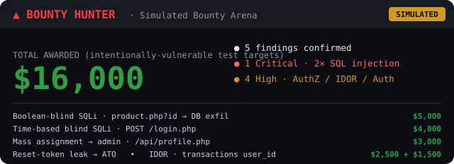
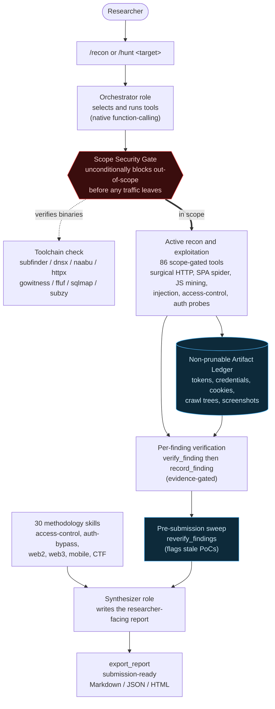

<p align="center">
  
</p>

<h1 align="center">BOUNTY HUNTER</h1>
<p align="center">
  <b>Autonomous AI Bug Bounty & Penetration Testing Framework — runs as <code>beast</code>, built by Project Hellhound</b>
  <br>
  <i>Target enumeration, two-tier neural reasoning, 30 methodology skills, persistent artifact blackboard, live SPA crawling, visual evidence capture, and zero-bypass scope guardrails — from recon to submission-ready report.</i>
</p>

<p align="center">
  <a href="#quick-start">Quick Start</a> ·
  <a href="#installation--setup">Installation & Setup</a> ·
  <a href="#two-tier-neural-routing">Two-Tier AI Routing</a> ·
  <a href="#commands">Commands</a> ·
  <a href="#the-recon--triage-arsenal">Arsenal</a> ·
  <a href="#what-it-finds">What It Finds</a> ·
  <a href="#hunting-methodology-skills">Skills</a> ·
  <a href="#recent-upgrades">Recent Upgrades</a> ·
  <a href="#roadmap--whats-next">Roadmap</a> ·
  <a href="#license">License</a>
</p>

<p align="center">
  <a href="https://www.python.org/"></a>
  <a href="https://github.com/project-hellhound-org/bounty-hunter/releases"></a>
  
  
  
  
</p>

---

> [!WARNING]
> ### ⚠️ Project Status — Where It Actually Stands
> **Bounty Hunter — "Beast" — is under active development.** Here's an honest read of how it performs across the environments it's run against, so you know what to expect before you point it at anything:
>
> - **PortSwigger Web Security Academy labs** — solves them **autonomously, end to end**, across multiple vulnerability classes: password-reset poisoning via host-header injection, deleting a user through an exposed API-documentation endpoint, reflected / stored / DOM-based XSS (confirmed by firing a real `alert()` in a headless browser), CORS, and SSRF. Not just recon — the full exploit.
> - **Hardened & intentionally-vulnerable ranges** (HackTheBox, CTFHub, local hardened labs) — recon, foothold, and exploitation hold up well.
> - **Real, authorized bug-bounty programs** — strong at recon, scoping, and triage; it surfaces and verifies genuine issues. But it is **not yet "fire and forget"** on production targets — **review every finding before you rely on it or submit it.**
>
> What it reports is meant to be a *confirmed* bug, not a guess: XSS has to actually execute in a browser to be recorded, `verify_finding` runs class-specific live checks, and a dismissed false positive can't silently reappear. Use responsibly and strictly on authorized targets.

---

## What Is This?

**Bounty Hunter** is the autonomous bug bounty reconnaissance and vulnerability triage framework developed by **Project Hellhound**. Built for security researchers, penetration testers, and CTF practitioners, Bounty Hunter autonomously maps attack surfaces, verifies discovered assets, spiders dynamic Single Page Applications (SPAs) for hidden APIs and secrets, captures visual screenshot evidence via Gowitness, executes security audits through an unconditional scope gate, and writes submission-ready reports for HackerOne, Bugcrowd, and private engagements.

It features **persistent target memory and an automated artifact blackboard**—harvested tokens, credentials, session cookies, open ports, crawl trees, visual screenshots, and triage notes are automatically retained in isolated per-target workspaces (`~/.hellhound/targets/<target>/`) so hunts seamlessly resume across sessions without token loss or "lost-in-the-middle" reasoning drops.

Works across two flexible interfaces:
- **Interactive Terminal**: An interactive terminal environment with real-time token streaming, live progress feedback, and inline command autocompletion (`beast`).
- **Headless CLI Runner**: Direct one-line command execution for quick scripts and CI/CD pipelines (`beast -p "prompt"`).

---

## Proving Ground — Simulated Bounty Arena

<p align="center">
  
</p>

> **What this is:** a controlled benchmark, not a real-world payout record. Bounty Hunter was run end-to-end against an **internal simulated bounty arena** — intentionally-vulnerable targets (e.g. a mock banking/storefront app) with a triage LLM acting as the program, validating each report and assigning a bounty. It's how we measure the thing the project cares about most: telling a *confirmed* bug apart from a false positive and capturing evidence strong enough to score. Every finding above was confirmed with real captured request/response evidence before it was awarded. Figures are simulated and do not represent real bug-bounty earnings.

---

## How It Works



> **Orchestrator vs Synthesizer are ROLES, not model tiers.** Orchestrator calls select/run tools (native function-calling); Synthesizer calls write the researcher-facing prose at the end of a turn. Both can point at the SAME model — e.g. the recommended NVIDIA Nemotron 550B config below runs both roles on one model — or at two different ones if you want a cheap/fast model for tool selection and a stronger one for write-ups. Either way, the synthesizer call is always made with the same tool schema attached (just set to "don't call anything"), so it stays in a consistent tool-aware frame of reference for the whole turn rather than being dropped into a schema-free completion right after a history full of the orchestrator's own tool-call JSON.

- **Scope Security Gate**: Unscoped targets are unconditionally blocked before any active network traffic leaves your system.
- **Harvested Artifact Ledger**: Harvested credentials, tokens, session cookies, and delegation endpoints are automatically captured into a structured, non-prunable blackboard and pinned to every turn.
- **Missing Tool Grace**: External tool dependencies are verified on-demand—missing binaries trigger guided installation prompts rather than crashing.
- **Persistent Workspace State**: Target assets, screenshots, history, and extracted findings are stored automatically in isolated target workspaces.

---

## Installation & Setup

Everything you need to install, configure AI backends, and run Bounty Hunter in one unified workflow. The steps below cover the quick path — for more detail on any one piece (model routing options, Burp, or Caido), see the [step-by-step setup guides](docs/README.md).

### 1. Requirements & Prerequisites
- **Operating System**: Linux (Kali, Ubuntu, Debian, Arch, Parrot OS), macOS (Apple Silicon & Intel), or Windows (WSL2).
- **Python**: Version 3.10 or higher (Python 3.12 / 3.13 recommended).
- **Go**: Version 1.20+ (Required for ProjectDiscovery tools, Gowitness, and FFUF).
- **Git & Curl**: Required for installation and updates.

### 2. Fast Deploy (One-Line Pipe or Git Clone)

#### Option A: One-Line Remote Installer
```bash
curl -fsSL https://raw.githubusercontent.com/project-hellhound-org/bounty-hunter/main/install.sh | bash
```

#### Option B: Standard Git Clone
```bash
git clone https://github.com/project-hellhound-org/bounty-hunter.git
cd bounty-hunter
chmod +x install.sh
./install.sh
```

#### Reload Shell Environment
```bash
source ~/.bashrc   # or source ~/.zshrc
```

The automated installer will:
- Set up an isolated Python virtual environment at `~/.beast-env`.
- Mount the headless browser & Playwright SPA engine with all system dependencies.
- Verify and install the offensive toolchain (`gowitness`, `subfinder`, `httpx`, `dnsx`, `naabu`, `ffuf`, `alterx`, `tlsx`, `shuffledns`, `subzy`).
- Create a global `beast` command symlink.

---

### 3. AI Backend Configuration

Beast runs two roles — an **Orchestrator** (selects/runs tools) and a **Synthesizer** (writes the researcher-facing report). You point each at a model with `/model orchestrator <provider> <id>` and `/model synthesizer <provider> <id>` (or `/model both <provider> <id>` to set both at once). Pick a provider below.

> [!TIP]
> ### 💡 Which model should I use?
> - **Free (recommended):** **NVIDIA NIM** — one free API key works against *any* model it serves (`nvidia/nemotron-3-ultra-550b-a55b`, `meta/llama-3.3-70b-instruct`, …; browse current IDs at [build.nvidia.com/models](https://build.nvidia.com/models), NVIDIA periodically retires old ones). Generous free credits, frontier-class reasoning, zero local GPU.
> - **Paid:** Anthropic **Claude 3.5 Sonnet**, Google **Gemini 2.0 Flash / Pro**, or **OpenAI GPT-4o**.
> - **Local (Ollama):** 32B+ models (`qwen2.5:32b`, `deepseek-r1:32b`) — small local models under 14B struggle with multi-stage IDOR chaining and strict JSON tool-calling.

#### A. Free Cloud AI via NVIDIA NIM (Strongly Recommended for Free Users)
Get free API credits and frontier-class 120B model inference with zero local GPU requirements:
1. Sign up at [build.nvidia.com](https://build.nvidia.com/) to obtain your free API key.
2. Export your key in your environment or `~/.bashrc`:
```bash
export NVIDIA_API_KEY="nvapi-your-key-here"
```
3. Inside Bounty Hunter, select Nemotron or Llama 3.3:
```bash
beast
> /model orchestrator nvidia nvidia/nemotron-3-ultra-550b-a55b
> /model synthesizer nvidia nvidia/nemotron-3-ultra-550b-a55b
```

#### B. Commercial Frontier Cloud Providers (Claude, Gemini, OpenAI)
For researchers with commercial API access:
```bash
# Anthropic Claude
export ANTHROPIC_API_KEY="sk-ant-..."

# Google Gemini
export GEMINI_API_KEY="AIza..."

# OpenAI
export OPENAI_API_KEY="sk-..."
```

Inside the console:
```bash
> /model synthesizer anthropic claude-3-5-sonnet
> /model synthesizer gemini gemini-2.0-flash
```

Want the same model doing both the orchestrator and synthesizer job? You
don't need to run `/model` twice — `/model both <provider> <model-id>`
sets both tiers at once (e.g. `/model both nvidia nvidia/nemotron-3-ultra-550b-a55b`).
See [AI Model Setup](docs/ai-model-setup.md) for the full picture, including
per-tier splits and session-only overrides.

#### C. Fully Offline Local AI (Ollama)
For air-gapped or 100% offline environments (32B+ models recommended for reliable tool chaining):
```bash
# 1. Install Ollama
curl -fsSL https://ollama.com/install.sh | sh

# 2. Pull local model
ollama pull qwen2.5:32b-instruct-q4_0

# 3. Connect inside Bounty Hunter
beast
> /model orchestrator ollama qwen2.5:32b-instruct-q4_0
> /model synthesizer ollama qwen2.5:32b-instruct-q4_0
```

---

### 4. Burp Suite & Caido Integration (MCP)

Bounty Hunter can drive Burp Suite and/or Caido directly as additional
tools, alongside its own built-in recon arsenal. Both are configured
inside the console with one command each — no manual config editing:

```bash
beast
> /mcp burp http://127.0.0.1:9876   # auto-detects Burp's MCP transport
> /mcp caido http://localhost:8080  # uses caido-mcp-server if installed, else falls back to built-in GraphQL
> /mcp                              # shows current config + live status for both
> /mcp test                         # re-checks without changing anything
```

Full step-by-step guides (where to find Burp's MCP tab, getting Caido's
token or setting up `caido-mcp-server`'s OAuth login, and a troubleshooting
table for each): [Burp Suite MCP Setup](docs/mcp-burp-setup.md) ·
[Caido Setup](docs/mcp-caido-setup.md).

---

### 5. Health Check & Tool Verification
Verify that your environment, AI models, and binary tools are fully connected:
```bash
beast
> /setup
> /setup tools
```

To enable automatic on-demand installation of any missing tools during scans:
```bash
> /setup tools auto-install on
```

#### Third-party recon tool API keys
A few recon tools call external services that need their own free API key (separate from your LLM provider key above) — `/setup` shows exactly which ones are set and which aren't, with a signup link for each. Set any of them with:
```bash
> /setup set-key <tool> <api_key>
```
Every tool in the arsenal that needs one is self-describing this way — run `/setup` any time to see current status rather than hunting through docs for which key goes where.

---

## Quick Start

### 1. Interactive Terminal
Launch the interactive terminal console with live autocomplete and syntax highlighting:
```bash
beast
```

### 2. Headless CLI Automation
Run one-off prompts and scripted pipeline jobs directly:
```bash
# Scoped reconnaissance against a domain
beast -p "recon targetcorp.example"

# Say what you actually want done — the agent picks the right skill and
# recon depth (active vs. passive) itself, it isn't hardcoded off the domain name
beast -p "target is https://lab.ctfio.com and creds user:pass, takeover admin account"

# Direct slash command execution with JSON output
beast -p "/hunt target.com --json"
```

### 3. Never used it before? Your first hunt in 4 steps

No prior security tooling knowledge needed — you talk to it in plain English.

1. **Launch it** — type `beast`. You land in the interactive terminal.
2. **Point it at a target, in plain words** — no flags, no tool names:
   > `scan example.com for common web vulnerabilities`

   It sets the target, chooses how deep to go, and starts. *(Only ever test targets you're authorized to — see [Scope Policy](#scope-policy--legal-compliance) below.)*
3. **Watch it work** — long scans appear as live cards on the right. Press **`Ctrl+P`** any time to browse every command, **`Ctrl+F`** to see findings so far.
4. **Review what it found** — run `/report` for a self-contained HTML report. **Always read a finding before you trust or submit it.**

> **Working a real program with many in-scope domains?** Group them once: `/program create acme example.com,api.example.com`, then `/program select acme` to enter it and `/list` to see its hosts. Everything you do from then on is saved under that program. Not sure what a command does? **`Ctrl+P`** fuzzy-searches them all.

---

## Commands

All actions can be triggered via slash commands or natural language:

### Core Slash Commands

| Command | Aliases | Description | Usage |
| :--- | :--- | :--- | :--- |
| `/recon` | `/surface`, `/spider` | Run scoped reconnaissance pipeline against target | `/recon <target> [--json]` |
| `/hunt` | `/auto` | Autonomous, scope-aware multi-stage hunt and triage | `/hunt [target] [--json]` |
| `/scan` | `/strike` | Execute a specific discovery or audit module | `/scan <module> [target] [key=val...]` |
| `/howl` | `/correlate`, `/graph` | Correlate discoveries or generate visual attack graph | `/howl [--graph] [target]` |
| `/scope` | `/rules` | View, clear, or configure program scope rules | `/scope [show \| clear \| <rules_text>]` |
| `/program` | `/programs`, `/engagement` | Group an engagement's in-scope domains under one shared scope; select/switch between them; mark private | `/program [select \| switch <name> [host] \| list [all] \| create <name> [domains] \| add <domain...> \| scope <text> \| private \| public \| rename <old> <new>]` |
| `/list` | `/ls`, `/hosts` | Metasploit-style view of the **current** program — its worked targets + in-scope hosts you can jump to | `/list` |
| `/output` | `/tail`, `/show-output` | Show the full captured output of the last long-running tool call | `/output [stderr] [N]` |
| `/skills` | `/skill` | Search or list loaded methodology skills & checklists | `/skills [query] [--json]` |
| `/model` | `/ai` | Inspect/switch active model for orchestrator/synthesizer | `/model [orchestrator\|synthesizer] <model-id>` |
| `/headers` | `/head` | Manage custom HTTP request & BugBounty identity headers | `/headers [Header: Value \| --clear]` |
| `/setup` | `/health`, `/doctor` | Check AI connectivity, tool dependencies & auto-install | `/setup [tools [auto-install on\|off]]` |
| `/report` | `/loot` | Generate structured bug bounty reconnaissance report | `/report [--format html\|json]` |
| `/ask` | `/chat` | Query co-pilot with session context and tool access | `/ask <question>` |
| `/help` | `/?` | Show all available slash commands and usage | `/help` |

---

## The Recon & Triage Arsenal

Bounty Hunter coordinates **86 scope-gated tools** into one execution pipeline. The orchestrator picks the right one for the job — you rarely call any by name. In brief, they cover:

- **Recon** — subdomain/DNS enumeration, port & TLS scanning, passive URL harvesting (Wayback/OTX/urlscan/VirusTotal), cloud-asset discovery, WAF fingerprinting.
- **Crawling & content discovery** — SPA spider, katana, content/vhost fuzzing, JS endpoint & secret mining.
- **Browser & visual** — a persistent headless Playwright browser that runs real JS (how DOM/stored XSS is *proven*, not guessed), auth-flow capture/replay, gowitness screenshots.
- **Exploitation & validation** — SQLi, XSS/SSRF/SSTI/CORS/IDOR probes with a live `verify_finding` check, JWT forging, GraphQL introspection, mass-assignment, host-header poisoning, 403-bypass, race conditions.
- **Session & workspace** — identity capture/swap, scope & program management, an out-of-band `listener`, `parallel`/`background_task` execution, `delegate` sub-agents, hypotheses & campaign plans.
- **Reporting** — finding recording with pre-submission re-verification and self-contained HTML export.

How they work: each runs behind the unconditional scope gate and rate limiter, writes evidence to the per-target artifact ledger, and feeds its result back to the orchestrator for the next decision. For the exact, live list and what any one does, just ask the agent (*"what tools do you have for X?"*) or run `self_audit` — that always reflects the real registry instead of a snapshot that drifts.

---

## What It Finds

### 1. Attack Surface Discovery
- **Subdomains**: Passive OSINT (`subfinder`) -> Permutations (`alterx`) -> MassDNS brute-forcing (`shuffledns`) -> Candidate resolving (`dnsx`).
- **Infrastructure**: TLS/SAN extraction (`tlsx`), Virtual host fuzzing (`vhost_fuzz`), and open port mapping (`naabu`).
- **Web & SPA Attack Surface**: Deep SPA DOM rendering, background XHR/Fetch request interception, dynamic route discovery, OpenAPI/Swagger specifications, and GraphQL endpoints.
- **Visual Mapping**: Automated browser screenshots via `gowitness` indexed directly into the target workspace.

### 2. Vulnerability & Exposure Indicators
- **Broken Access Control & IDOR**: Direct object reference leaks in client-side state (`window.__INIT_PROFILE__`), authorization bypass via parameter swapping, and privilege escalation.
- **Authentication & Delegation Flaws**: Leaked auth tokens, impersonation handler bypasses, JWT algorithm confusion, and session fixation.
- **Dangling CNAME Takeovers**: Detection of orphaned DNS pointers to unclaimed S3 buckets, GitHub Pages, Azure services, and Heroku apps.
- **Sensitive Data & Secrets**: API keys, bearer tokens, PII leaks, internal endpoints, and CTF flag formats in client-side code and API responses.

---

## Hunting Methodology Skills

Bounty Hunter includes **30 specialized methodology skills**, loaded dynamically into the agent's reasoning context only when a turn actually needs one — not injected all at once.

| Category | Skills |
| :--- | :--- |
| **Access Control & Auth** | `access-control` `auth-bypass` `authentication` `idor` `credential-attack` `403-bypass` |
| **Web Vulnerability Classes** | `web2-vuln-classes` `xss` `ssrf` `ssti` `insecure-deserialization` `prototype-pollution-mass-assignment` `server-side-parameter-pollution` `cors-misconfig` `race-condition` |
| **Recon & Methodology** | `web2-recon` `bb-methodology` `bug-bounty` `exposed-source-recon` `argus` `security-arsenal` `graphql-audit` |
| **Specialized Targets** | `web3-audit` `meme-coin-audit` `mobile-pentest` `client-reverse` `cicd-security` `llm-prompt-injection` |
| **Validation & Reporting** | `triage-validation` `report-writing` |

You don't need to invoke these yourself — the agent pulls in whichever one a turn actually needs on its own.

---

## Recent Upgrades

Highlights of recent work (full history in [CHANGELOG.md](CHANGELOG.md)):

- **Solves PortSwigger labs end-to-end** — reset-poisoning via host-header injection, exposed-API-doc user deletion, reflected / stored / DOM XSS (real browser `alert()`), CORS.
- **Exploitation validation hardened** — XSS gated on real browser execution (a browser-disproved payload is refused, not recorded), `verify_finding` live class-checks, dismissed false positives can't silently re-appear, per-finding report splitting.
- **Tool-calling made robust** — native-function-calling-first across every provider; the reasoning-model preamble that used to truncate calls mid-JSON is disabled; a provably regex-free path on Claude.
- **Identity & session model** — `capture_identity`/`swap_session` and `save_auth_flow`/`replay_auth_flow`, bridged into the headless browser and the fuzzers.
- **Textual TUI** — full-screen console with clickable, collapsible request/response cards (classic REPL still available via `HELLHOUND_CLASSIC_UI=1`).
- **Codebase refactor** — the 20k-line `agent.py` is being split into focused `tools/` modules (one file per tool domain), each change gated by an AST import scan + smoke test.

---

## Roadmap — What's Next

The real gap between "runs tools well" and "hunts like a pro" is architecture, not more tools. Fuller reasoning in [CHANGELOG.md](CHANGELOG.md).

**Already landed** (was on this list, now shipped):
- Passive recon surface — Wayback, OTX, urlscan, `gau` → `nuclei`, and CT-log subdomain sweeps are live tools.
- Scriptable browser with record/replay of auth flows (`save_auth_flow` / `replay_auth_flow`) and live request observation.
- Native-function-calling tool execution across every provider.

**Open, in rough priority:**
1. **Browser request *interception*** — the browser already observes traffic; modifying or blocking requests mid-flight is what's left.
2. **Burp/Caido ↔ identity bridge** — push/pull live sessions through the already-integrated MCP tools.
3. **Passive → active fusion** — the passive tools exist; wiring their output *automatically* into the probing/fuzzing loop (dedup, JS sourcemap → secrets → endpoints → fuzzer) is the remaining glue.
4. **A playbook engine** — conditional branching workflows, not just sequential tool chaining.

---


## Scope Policy & Legal Compliance

Bounty Hunter is built strictly for **authorized security assessments, bug bounty programs, and educational CTF training environments**.
- The built-in Scope Security Gate refuses commands targeting assets outside your configured scope rules.
- Always obtain explicit written authorization before testing any target.
- Users are solely responsible for ensuring compliance with all applicable laws and program guidelines.

---

## License

This project is licensed under the [GNU General Public License v3 (GPLv3)](LICENSE). The "Hellhound"/"Bounty Hunter" name and logo are trademarks, separate from the code license — see [NOTICE](NOTICE) for what that does and doesn't mean for forks. Contributing (human or AI-assisted)? Read [CONTRIBUTING.md](CONTRIBUTING.md) first, and point your AI coding assistant at [AGENTS.md](AGENTS.md) — a few rules (the scope gate above all) are non-negotiable regardless of how reasonable a change sounds.

---

## Author

<p align="center">
  <a href="https://l4zz3rj0d.github.io">
    
  </a>
</p>