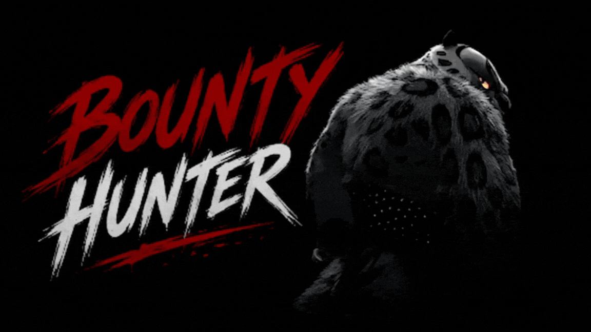

<p align="center">
  
</p>

<h1 align="center">HELLHOUND : BOUNTY HUNTER</h1>
<p align="center">
  <b>Autonomous AI Bug Bounty & Penetration Testing Framework by Project Hellhound</b>
  <br>
  <i>Target enumeration, two-tier neural reasoning, 30 methodology skills, persistent artifact blackboard, live SPA crawling, visual evidence capture, and zero-bypass scope guardrails — from recon to submission-ready report.</i>
</p>

<p align="center">
  <a href="#quick-start">Quick Start</a> ·
  <a href="#installation--setup">Installation & Setup</a> ·
  <a href="#two-tier-neural-routing">Two-Tier AI Routing</a> ·
  <a href="#commands">Commands</a> ·
  <a href="#the-recon--triage-arsenal">Arsenal</a> ·
  <a href="#what-it-finds">What It Finds</a> ·
  <a href="#hunting-methodology-skills">Skills</a> ·
  <a href="#license">License</a>
</p>

<p align="center">
  <a href="https://www.python.org/"></a>
  <a href="https://github.com/project-hellhound-org/bounty-hunter/releases"></a>
  
  
  
  
</p>

---

> [!WARNING]
> ### ⚠️ Project Status & Active Development Notice
> **Hellhound Bounty Hunter is currently under active development.** While it features automated multi-stage exploit chaining, two-tier neural routing, non-prunable artifact memory, and visual PoC verification, it is **not yet fully battle-tested on live production bug bounty targets**. Extensive testing and validation are actively ongoing across intentionally vulnerable CTF ranges (HackTheBox, CTFHub, PortSwigger Web Security Academy) and hardened local test environments. Use responsibly and strictly on authorized targets.

---

## What Is This?

**Bounty Hunter** is the autonomous bug bounty reconnaissance and vulnerability triage framework developed by **Project Hellhound**. Built for security researchers, penetration testers, and CTF practitioners, Bounty Hunter autonomously maps attack surfaces, verifies discovered assets, spiders dynamic Single Page Applications (SPAs) for hidden APIs and secrets, captures visual screenshot evidence via Gowitness, executes security audits through an unconditional scope gate, and writes submission-ready reports for HackerOne, Bugcrowd, and private engagements.

It features **persistent target memory and an automated artifact blackboard**—harvested tokens, credentials, session cookies, open ports, crawl trees, visual screenshots, and triage notes are automatically retained in isolated per-target workspaces (`~/.hellhound/targets/<target>/`) so hunts seamlessly resume across sessions without token loss or "lost-in-the-middle" reasoning drops.

Works across two flexible interfaces:
- **Interactive Terminal**: An interactive terminal environment with real-time token streaming, live progress feedback, and inline command autocompletion (`hellhound`).
- **Headless CLI Runner**: Direct one-line command execution for quick scripts and CI/CD pipelines (`hellhound -p "prompt"`).

---

## How It Works

```
You ──> /recon target.com ──> Orchestrator (Tool Selection) ──> Scope Security Gate
                                     │                            │ (Blocks out-of-scope)
                                     ▼                            ▼
                          Active Reconnaissance        Binary Toolchain Verification
                          ├─ Low-Noise Surgical HTTP   (Subfinder, DNSX, Naabu, HTTPX)
                          ├─ Shuffledns + AlterX       (Gowitness, FFUF, Subzy)
                          ├─ MassDNS + TLSX            (Native BAC & Logic Auditors)
                          └─ Headless SPA Spider      
                                     │
                                     ▼ (Populates Non-Prunable Artifact Ledger)
                          Synthesizer (Report Write-up) <── 30 Methodology Skills
                                     │                     (Access Control, Auth Bypass,
                                     ▼                      Web2, Web3, Mobile, CTF)
                                /report (Submission-ready markdown/JSON/HTML)
```

> **Orchestrator vs Synthesizer are ROLES, not model tiers.** Orchestrator calls select/run tools (native function-calling); Synthesizer calls write the researcher-facing prose at the end of a turn. Both can point at the SAME model — e.g. the recommended NVIDIA Nemotron 550B config below runs both roles on one model — or at two different ones if you want a cheap/fast model for tool selection and a stronger one for write-ups. Either way, the synthesizer call is always made with the same tool schema attached (just set to "don't call anything"), so it stays in a consistent tool-aware frame of reference for the whole turn rather than being dropped into a schema-free completion right after a history full of the orchestrator's own tool-call JSON.

- **Scope Security Gate**: Unscoped targets are unconditionally blocked before any active network traffic leaves your system.
- **Harvested Artifact Ledger**: Harvested credentials, tokens, session cookies, and delegation endpoints are automatically captured into a structured, non-prunable blackboard and pinned to every turn.
- **Missing Tool Grace**: External tool dependencies are verified on-demand—missing binaries trigger guided installation prompts rather than crashing.
- **Persistent Workspace State**: Target assets, screenshots, history, and extracted findings are stored automatically in isolated target workspaces.

---

## AI Model Routing & Recommended Providers

Autonomous vulnerability exploitation and multi-step attack chaining require models with high reasoning fidelity, reliable JSON tool execution, and complex state tracking.

> [!TIP]
> ### 💡 Recommended AI Providers (Free & Paid)
> - **For Free Users (Strongly Recommended)**: Use **NVIDIA NIM** (one free API key works against ANY model NIM serves — e.g. `nvidia/nemotron-3-ultra-550b-a55b` or `meta/llama-3.3-70b-instruct`; browse current model IDs at [build.nvidia.com/models](https://build.nvidia.com/models), NVIDIA periodically retires old ones). NVIDIA provides **generous free API credits** with access to massive frontier models, delivering high-speed inference and exceptional reasoning at zero cost.
> - **For Paid API Users**: Use **Anthropic Claude 3.5 Sonnet**, **Google Gemini 2.0 Flash / Pro**, or **OpenAI GPT-4o**.
> - **Local Models (Ollama)**: While supported for fully offline environments, small local models (SLMs under 14B) may struggle with nuanced multi-stage IDOR chaining and complex JSON schema adherence. For local setups, 32B+ models (e.g. `qwen2.5:32b` or `deepseek-r1:32b`) are recommended if hardware permits.

```bash
# Inspect active model routing status
> /model

# Configure NVIDIA NIM (Recommended Free Tier - Ultra Fast 120B Reasoning)
> /model orchestrator nvidia nvidia/nemotron-3-ultra-550b-a55b
> /model synthesizer nvidia nvidia/nemotron-3-ultra-550b-a55b
> # Any other NIM model ID works too — the same API key covers all of them:
> /model synthesizer nvidia <any-model-id-from-build.nvidia.com/models>

# Or configure Claude / Gemini for advanced cloud reasoning
> /model synthesizer anthropic claude-3-5-sonnet
> /model synthesizer gemini gemini-2.0-flash
```

---

## Installation & Setup

Everything you need to install, configure AI backends, and run Bounty Hunter in one unified workflow. The steps below cover the quick path — for more detail on any one piece (model routing options, Burp, or Caido), see the [step-by-step setup guides](docs/README.md).

### 1. Requirements & Prerequisites
- **Operating System**: Linux (Kali, Ubuntu, Debian, Arch, Parrot OS), macOS (Apple Silicon & Intel), or Windows (WSL2).
- **Python**: Version 3.10 or higher (Python 3.12 / 3.13 recommended).
- **Go**: Version 1.20+ (Required for ProjectDiscovery tools, Gowitness, and FFUF).
- **Git & Curl**: Required for installation and updates.

### 2. Fast Deploy (One-Line Pipe or Git Clone)

#### Option A: One-Line Remote Installer
```bash
curl -fsSL https://raw.githubusercontent.com/project-hellhound-org/bounty-hunter/main/install.sh | bash
```

#### Option B: Standard Git Clone
```bash
git clone https://github.com/project-hellhound-org/bounty-hunter.git
cd bounty-hunter
chmod +x install.sh
./install.sh
```

#### Reload Shell Environment
```bash
source ~/.bashrc   # or source ~/.zshrc
```

The automated installer will:
- Set up an isolated Python virtual environment at `~/.hellhound-env`.
- Mount the headless browser & Playwright SPA engine with all system dependencies.
- Verify and install the offensive toolchain (`gowitness`, `subfinder`, `httpx`, `dnsx`, `naabu`, `ffuf`, `alterx`, `tlsx`, `shuffledns`, `subzy`).
- Create a global `hellhound` command symlink.

---

### 3. AI Backend Configuration

#### A. Free Cloud AI via NVIDIA NIM (Strongly Recommended for Free Users)
Get free API credits and frontier-class 120B model inference with zero local GPU requirements:
1. Sign up at [build.nvidia.com](https://build.nvidia.com/) to obtain your free API key.
2. Export your key in your environment or `~/.bashrc`:
```bash
export NVIDIA_API_KEY="nvapi-your-key-here"
```
3. Inside Bounty Hunter, select Nemotron or Llama 3.3:
```bash
hellhound
> /model orchestrator nvidia nvidia/nemotron-3-ultra-550b-a55b
> /model synthesizer nvidia nvidia/nemotron-3-ultra-550b-a55b
```

#### B. Commercial Frontier Cloud Providers (Claude, Gemini, OpenAI)
For researchers with commercial API access:
```bash
# Anthropic Claude
export ANTHROPIC_API_KEY="sk-ant-..."

# Google Gemini
export GEMINI_API_KEY="AIza..."

# OpenAI
export OPENAI_API_KEY="sk-..."
```

Inside the console:
```bash
> /model synthesizer anthropic claude-3-5-sonnet
> /model synthesizer gemini gemini-2.0-flash
```

Want the same model doing both the orchestrator and synthesizer job? You
don't need to run `/model` twice — `/model both <provider> <model-id>`
sets both tiers at once (e.g. `/model both nvidia nvidia/nemotron-3-ultra-550b-a55b`).
See [AI Model Setup](docs/ai-model-setup.md) for the full picture, including
per-tier splits and session-only overrides.

#### C. Fully Offline Local AI (Ollama)
For air-gapped or 100% offline environments (32B+ models recommended for reliable tool chaining):
```bash
# 1. Install Ollama
curl -fsSL https://ollama.com/install.sh | sh

# 2. Pull local model
ollama pull qwen2.5:32b-instruct-q4_0

# 3. Connect inside Bounty Hunter
hellhound
> /model orchestrator ollama qwen2.5:32b-instruct-q4_0
> /model synthesizer ollama qwen2.5:32b-instruct-q4_0
```

---

### 4. Burp Suite & Caido Integration (MCP)

Bounty Hunter can drive Burp Suite and/or Caido directly as additional
tools, alongside its own built-in recon arsenal. Both are configured
inside the console with one command each — no manual config editing:

```bash
hellhound
> /mcp burp http://127.0.0.1:9876   # auto-detects Burp's MCP transport
> /mcp caido http://localhost:8080  # uses caido-mcp-server if installed, else falls back to built-in GraphQL
> /mcp                              # shows current config + live status for both
> /mcp test                         # re-checks without changing anything
```

Full step-by-step guides (where to find Burp's MCP tab, getting Caido's
token or setting up `caido-mcp-server`'s OAuth login, and a troubleshooting
table for each): [Burp Suite MCP Setup](docs/mcp-burp-setup.md) ·
[Caido Setup](docs/mcp-caido-setup.md).

---

### 5. Health Check & Tool Verification
Verify that your environment, AI models, and binary tools are fully connected:
```bash
hellhound
> /setup
> /setup tools
```

To enable automatic on-demand installation of any missing tools during scans:
```bash
> /setup tools auto-install on
```

#### Third-party recon tool API keys
A few recon tools call external services that need their own free API key (separate from your LLM provider key above) — `/setup` shows exactly which ones are set and which aren't, with a signup link for each. Set any of them with:
```bash
> /setup set-key <tool> <api_key>
```
Every tool in the arsenal that needs one is self-describing this way — run `/setup` any time to see current status rather than hunting through docs for which key goes where.

---

## Quick Start

### 1. Interactive Terminal
Launch the interactive terminal console with live autocomplete and syntax highlighting:
```bash
hellhound
```

### 2. Headless CLI Automation
Run one-off prompts and scripted pipeline jobs directly:
```bash
# Scoped reconnaissance against a domain
hellhound -p "recon targetcorp.example"

# Say what you actually want done — the agent picks the right skill and
# recon depth (active vs. passive) itself, it isn't hardcoded off the domain name
hellhound -p "target is https://lab.ctfio.com and creds user:pass, takeover admin account"

# Direct slash command execution with JSON output
hellhound -p "/hunt target.com --json"
```

---

## Commands

All actions can be triggered via slash commands or natural language:

### Core Slash Commands

| Command | Aliases | Description | Usage |
| :--- | :--- | :--- | :--- |
| `/recon` | `/surface`, `/spider` | Run scoped reconnaissance pipeline against target | `/recon <target> [--json]` |
| `/hunt` | `/auto` | Autonomous, scope-aware multi-stage hunt and triage | `/hunt [target] [--json]` |
| `/scan` | `/strike` | Execute a specific discovery or audit module | `/scan <module> [target] [key=val...]` |
| `/howl` | `/correlate`, `/graph` | Correlate discoveries or generate visual attack graph | `/howl [--graph] [target]` |
| `/scope` | `/rules` | View, clear, or configure program scope rules | `/scope [show \| clear \| <rules_text>]` |
| `/skills` | `/skill` | Search or list loaded methodology skills & checklists | `/skills [query] [--json]` |
| `/model` | `/ai` | Inspect/switch active model for orchestrator/synthesizer | `/model [orchestrator\|synthesizer] <model-id>` |
| `/headers` | `/head` | Manage custom HTTP request & BugBounty identity headers | `/headers [Header: Value \| --clear]` |
| `/setup` | `/health`, `/doctor` | Check AI connectivity, tool dependencies & auto-install | `/setup [tools [auto-install on\|off]]` |
| `/report` | `/loot` | Generate structured bug bounty reconnaissance report | `/report [--format html\|json]` |
| `/ask` | `/chat` | Query co-pilot with session context and tool access | `/ask <question>` |
| `/help` | `/?` | Show all available slash commands and usage | `/help` |

---

## The Recon & Triage Arsenal

Bounty Hunter coordinates **50 tools** into a unified, scope-governed execution pipeline — recon, active probing, logic/BAC auditing, cloud asset discovery, takeover checks, threat intel, and local workspace/reporting utilities:

```
403_bypass · cloudscout · content_discovery · cookie_inspector ·
cors_checker · curl · delete_file · dig · dismiss_finding ·
dns_bruteforce · export_report · fuzz_hunter · gau_nuclei_sweep ·
generate_cors_poc · google_dork · gowitness · graphql_probe ·
hackerone_policy · hackerone_search · hackerone_stats · httpx ·
hydra · jwt_forge · listener · load_skill · manage_scope ·
nmap_service_scan · otx_urls · permute_subdomains · port_scan ·
punycode_homoglyphs · read_artifact · record_finding ·
resolve_candidates · run_terminal_command · save_file · set_target ·
spider · sqlmap_scan · subfinder · subzy · surface_auditor ·
takeover_scanner · tls_cert_scan · transport_auditor ·
urlscan_recon · vhost_fuzz · virustotal_lookup · wafbuster ·
wayback_urls
```

Ask the agent itself ("what tools do you have for X?") for what any one of these actually does — asking beats a wall of description text here, and the answer always reflects the real, current tool list instead of a snapshot that can drift out of date.

---

## What It Finds

### 1. Attack Surface Discovery
- **Subdomains**: Passive OSINT (`subfinder`) -> Permutations (`alterx`) -> MassDNS brute-forcing (`shuffledns`) -> Candidate resolving (`dnsx`).
- **Infrastructure**: TLS/SAN extraction (`tlsx`), Virtual host fuzzing (`vhost_fuzz`), and open port mapping (`naabu`).
- **Web & SPA Attack Surface**: Deep SPA DOM rendering, background XHR/Fetch request interception, dynamic route discovery, OpenAPI/Swagger specifications, and GraphQL endpoints.
- **Visual Mapping**: Automated browser screenshots via `gowitness` indexed directly into the target workspace.

### 2. Vulnerability & Exposure Indicators
- **Broken Access Control & IDOR**: Direct object reference leaks in client-side state (`window.__INIT_PROFILE__`), authorization bypass via parameter swapping, and privilege escalation.
- **Authentication & Delegation Flaws**: Leaked auth tokens, impersonation handler bypasses, JWT algorithm confusion, and session fixation.
- **Dangling CNAME Takeovers**: Detection of orphaned DNS pointers to unclaimed S3 buckets, GitHub Pages, Azure services, and Heroku apps.
- **Sensitive Data & Secrets**: API keys, bearer tokens, PII leaks, internal endpoints, and CTF flag formats in client-side code and API responses.

---

## Hunting Methodology Skills

Bounty Hunter includes **30 specialized methodology skills**, loaded dynamically into the agent's reasoning context only when a turn actually needs one — not injected all at once:

```
403-bypass · access-control · argus · auth-bypass · authentication ·
bb-methodology · bug-bounty · cicd-security · client-reverse ·
cors-misconfig · credential-attack · exposed-source-recon ·
graphql-audit · idor · insecure-deserialization ·
llm-prompt-injection · meme-coin-audit · mobile-pentest ·
prototype-pollution-mass-assignment · race-condition ·
report-writing · security-arsenal · server-side-parameter-pollution ·
ssrf · ssti · triage-validation · web2-recon · web2-vuln-classes ·
web3-audit · xss
```

Search skills anytime inside the console:
```bash
> /skills auth
> /skills ctf
> /skills graphql
```

---

## Scope Policy & Legal Compliance

Bounty Hunter is built strictly for **authorized security assessments, bug bounty programs, and educational CTF training environments**.
- The built-in Scope Security Gate refuses commands targeting assets outside your configured scope rules.
- Always obtain explicit written authorization before testing any target.
- Users are solely responsible for ensuring compliance with all applicable laws and program guidelines.

---

## License

This project is licensed under the [GNU General Public License v3 (GPLv3)](LICENSE).

---

## Author

<p align="center">
  <a href="https://l4zz3rj0d.github.io">
    
  </a>
</p>